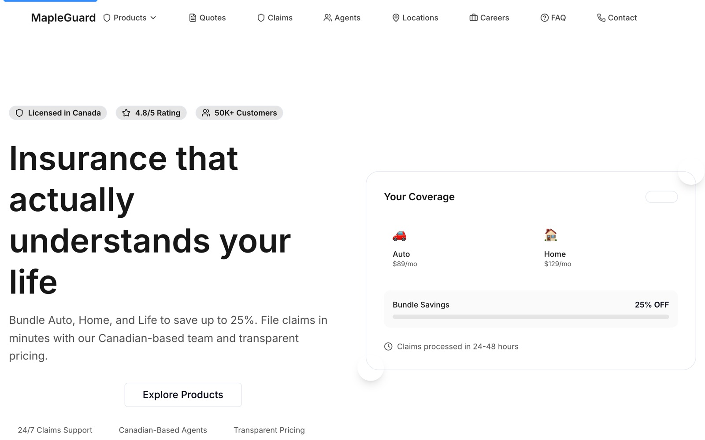

<div align="center">

# 🍁 MapleGuard Insurance

A modern, accessible insurance website for a Canadian provider, with product pages, a multi-step quote flow, claims information and agent locations.

<a href="https://miladmo68.github.io/MapleGuard-Insurance/"></a>
<a href="https://github.com/miladmo68/MapleGuard-Insurance"></a>
<a href="https://miladweb.com"></a>

**🔗 Live:** [miladmo68.github.io/MapleGuard-Insurance](https://miladmo68.github.io/MapleGuard-Insurance/)

</div>

<p align="center">
  
</p>

## ✨ Features

- Auto, home, life and business product pages
- Multi-step quote form with React Hook Form and Zod
- Claims, agents, locations, careers and FAQ pages
- Accessibility page and structured data for SEO
- Static export deployed to GitHub Pages

## 🛠️ Tech Stack

       

## 🚀 Getting Started

**Prerequisites:** [Node.js](https://nodejs.org/) 18 or newer

**Install and run**

```bash
git clone https://github.com/miladmo68/MapleGuard-Insurance.git
cd MapleGuard-Insurance
npm install
npm run dev
```

### Environment variables

Create a `.env` file (or `.env.local` for Next.js) with:

```env
NEXT_PUBLIC_GOOGLE_VERIFICATION=
NEXT_PUBLIC_SITE_URL=
```

## 📁 Project Structure

```
MapleGuard-Insurance/
├── public/
├── src/
├── eslint.config.mjs
├── next-env.d.ts
├── next.config.ts
├── package.json
├── postcss.config.mjs
├── ProjectContext.md
├── tailwind.config.ts
└── tsconfig.json
```

## 👤 Author

**Milad Mohammadi** — Frontend-Focused Full-Stack Developer, Toronto 🇨🇦

[](https://miladweb.com)
[](https://www.linkedin.com/in/miladmo68/)
[](https://github.com/miladmo68)

<p align="center"><sub>If you like this project, consider giving it a ⭐</sub></p>
